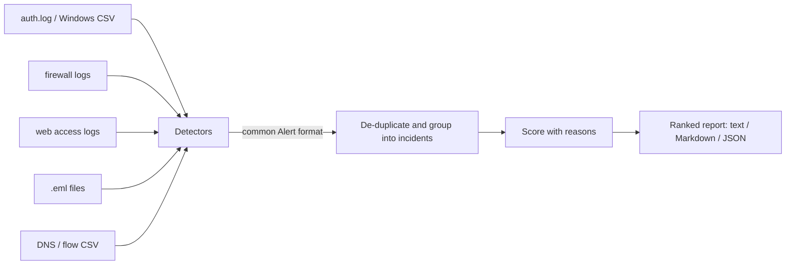

# AlertSift

**Explainable security alert triage.** AlertSift turns hundreds of raw alerts from authentication, firewall, web, email and DNS logs into a short, ranked list of incidents, and tells you *why* each one ranked where it did.


## The problem

SOC analysts are buried in alerts, and most of them turn out to be harmless. Published industry surveys report that:

- about half of SOC analysts name alert fatigue as their biggest challenge, with 60-70% of alerts being benign ([Abnormal AI](https://abnormal.ai/learning/alert-fatigue-cybersecurity));
- 76% of SOCs struggle with alert fatigue and 64% still rely mostly on manual detection, triage and investigation, in a survey of 739 security leaders ([IT Brief](https://itbrief.co.uk/story/ai-adoption-in-socs-cuts-alert-fatigue-but-integration-lags));
- SOCs receive thousands of alerts a day, leave roughly two-thirds unaddressed, and spend close to three hours of an analyst's day on manual triage ([Stealth Agents summary of 2023 survey data](https://stealthagents.com/research/cybersecurity-alert-triage-workload-statistics-2026)).

(Figures are as reported by those sources; I have not independently verified them.)

Commercial SOAR and AI-triage products tackle this. AlertSift is a small, open, dependency-free implementation of the core ideas (de-duplicate, group, score with reasons) that you can read in an afternoon.

**Design principle:** triage automation should gather evidence, not replace the analyst. It should keep scoring inputs reproducible and leave a point where a person reviews the result ([Gurucul, via NHI Mgmt Group](https://nhimg.org/articles/ai-augmented-siem-changes-how-soc-teams-manage-investigation-time/)). So every score in AlertSift is a sum of plain-English reasons, never a black box.

## Demo

Run on the bundled synthetic logs (`sample_logs/`), covering all five attack types:

```text
233 raw alerts -> 8 incidents (97% less to review)

#   ID            SEVERITY  SCORE  TYPE          SOURCE                         ALERTS
1   INC-538600B0  CRITICAL    100  auth_attack   45.33.32.156                       61
2   INC-EF34061E  CRITICAL     90  auth_attack   10.0.2.15                           9
3   INC-4A17C486  HIGH         85  c2_beaconing  10.0.0.23                          45
4   INC-ED9A010C  HIGH         70  port_scan     45.33.32.156                       54
5   INC-5A87860A  HIGH         60  port_scan     10.0.2.15                          40
6   INC-3876010F  MEDIUM       55  web_attack    93.184.216.34                      15
7   INC-8ADB33F6  MEDIUM       50  auth_attack   kali                                4
8   INC-3FECE69A  MEDIUM       35  phishing      billing@paypa1-secure.example       5
```

The top incident, with its score explained:

```text
[1] INC-538600B0 - CRITICAL (score 100)
    Why this score:
      +10 baseline for auth_attack
      +20 61 alerts in 5 min (high volume)
      +15 burst of about 12 alerts per minute (likely automated)
      +10 touched 5 different targets
      +10 source is an external (public) IP address
      +10 a privileged account was targeted
      +40 indicator of successful compromise (e.g. login success after failures, active beacon)
      +20 same source also seen in: port_scan (possible multi-stage attack)
```

Note the last line: the attacker's brute-force incident was linked to the port scan from the **same source** a few minutes earlier, and scored higher for it. The 233 raw alerts became 8 incidents.

## How it works



1. **Detectors** read one log type each and emit `Alert` objects in a single common format (UTC timestamps, actor, target, evidence, MITRE ATT&CK id).
2. **Grouping** removes exact duplicates and merges alerts from the same source and attack type into one incident, splitting on quiet gaps (15 minutes for most types, 24 hours for phishing campaigns).
3. **Scoring** adds up rules, each with a reason. Detectors can mark an alert as a compromise indicator; the same source appearing in several attack types gets a multi-stage bonus.
4. **Reports** come out as a console table, Markdown you can paste into a ticket, or JSON.

Because everything after step 1 only sees the common format, adding a new attack type never touches the core.

## Install and quick start

Requires Python 3.9+. No third-party runtime dependencies.

```bash
git clone https://github.com/Royalian28/alertsift.git
cd alertsift
python -m venv .venv
.venv\Scripts\Activate.ps1        # Windows PowerShell   (Linux/macOS: source .venv/bin/activate)
pip install -e ".[dev]"
pytest
```

Run it on the sample data (`--year` is only needed for classic syslog lines, which carry no year):

```bash
alertsift --auth sample_logs/auth.log sample_logs/windows_security.csv --portscan sample_logs/firewall.log sample_logs/pfirewall.log --web sample_logs/access.log --phishing sample_logs/emails --c2 sample_logs/dns.csv --year 2026
```

More examples:

```bash
alertsift --auth /var/log/auth.log                                   # your own Linux server
alertsift --web access.log --format markdown -o report.md            # paste-ready ticket text
alertsift --auth auth.log --allowlist my_scanners.txt --fail-on high # exit code 1 if any HIGH+ incident
```

## What it detects

| Detector | Flag | Reads | Looks for | ATT&CK |
|---|---|---|---|---|
| auth | `--auth` | Linux `auth.log` / `secure` (classic and ISO timestamps); Windows Security events exported from Splunk as CSV (4624/4625) | Brute force, password spraying, a login that succeeds after 3+ failures within 15 minutes | T1110 |
| portscan | `--portscan` | UFW/iptables kernel logs; Windows Firewall `pfirewall.log` | One source hitting 10+ distinct ip:port pairs within 60 seconds (blocked traffic) | T1046 |
| web | `--web` | Apache/nginx combined access logs | SQL injection, XSS, path traversal, command injection, scanner User-Agents; mapped to OWASP Top 10 (2021) | T1190 |
| phishing | `--phishing` | `.eml` files (file or folder) | SPF/DKIM/DMARC failures, Reply-To mismatch, brand impersonation, look-alike domains, deceptive links, urgency language, risky attachments | T1566 |
| c2 | `--c2` | CSV with time, source, destination columns (e.g. Splunk `\| table _time src dest`) | Regular-interval beaconing, tolerant of jitter | T1071 |

Each flag takes one or more files or folders.

## How scoring works

| Signal | Points |
|---|---|
| Baseline by type: auth 10, port scan 5, web 10, phishing 15, C2 25 | +5 to +25 |
| Volume: 5+ alerts / 20+ / 100+ | +10 / +20 / +30 |
| Burst: 10+ alerts at 10+ per minute (likely automated) | +15 |
| Spread: 3+ targets / 10+ targets | +10 / +20 |
| Source is an external (public) IP | +10 |
| A privileged account was targeted (root, administrator, admin, system) | +10 |
| Detector flagged a compromise indicator | +40 |
| Same source also seen in a different attack type (multi-stage) | +20 |
| Allowlist (known scanner) / blocklist (known bad) | -30 / +30 |

Scores are capped at 100. Severity bands: 0-29 low, 30-59 medium, 60-89 high, 90-100 critical. The full list of contributing reasons is stored on every incident and printed in every report.

The weights are **heuristic starting points**, not values fitted to production data. They are constants in `alertsift/scoring.py`, and you can add your own rules as enrichers.

## Add your own detector

A detector is one small class. Once registered, its command-line flag exists automatically and its alerts go through the same grouping, scoring and reporting. This is from [`examples/custom_detector.py`](examples/custom_detector.py) (run it with `python examples/custom_detector.py`):

```python
@register
class LongDnsNameDetector(Detector):
    name = "longdns"                      # becomes the --longdns flag
    alert_type = AlertType.C2_BEACONING
    description = "Very long DNS names (possible tunnelling); CSV lines of: time,src,name"

    def detect(self, path):
        for line in read_lines(Path(path)):
            stamp, src, name = (part.strip() for part in line.split(",")[:3])
            when = parse_timestamp(stamp)
            if when and len(name) > 50:
                yield Alert(self.alert_type, when, "dns", src, name[:30],
                            description=f"{len(name)}-character DNS name",
                            mitre="T1071.004", raw=line)
```

A detector can set `evidence={"compromise": True}` on an alert to tell the scorer the attacker may have succeeded.

## Use it as a library

```python
from alertsift.detectors import get_detector
from alertsift.grouping import group_alerts, reduction_stats
from alertsift.scoring import score_incidents
from alertsift.report import to_markdown

alerts = list(get_detector("auth", year=2026).detect("sample_logs/auth.log"))
incidents = group_alerts(alerts)
stats = reduction_stats(len(alerts), incidents)
print(to_markdown(score_incidents(incidents), stats))
```

See [`examples/library_usage.py`](examples/library_usage.py).

## Project layout

```text
alertsift/
  schema.py        common Alert / Incident data model (UTC-normalised)
  grouping.py      de-duplication and incident grouping
  scoring.py       explainable scoring, allowlist/blocklist enrichers
  report.py        text / Markdown / JSON output
  cli.py           command-line interface (flags are generated from the detector registry)
  detectors/       auth, portscan, web, phishing, c2 (+ base class and shared helpers)
sample_logs/       synthetic logs for all five detectors
tools/             generate_sample_logs.py (recreates sample_logs/)
examples/          library usage and a custom detector
tests/             pytest suite
```

## Testing

```bash
pytest
```

99 tests cover the data model, grouping edge cases (late and unsorted alerts, per-type windows), every scoring rule, each detector (including the cases that should stay silent, such as normal web traffic, legitimate email, slow scans and known-benign periodic DNS), the CLI, and the plug-in mechanism. The suite was run on Python 3.9, 3.10, 3.11, 3.12 and 3.13. A GitHub Actions workflow (`.github/workflows/tests.yml`) is included to run it on Linux and Windows for every push.

## Design decisions

- **Explainable over clever.** A rule-based score with listed reasons can be audited and tuned by an analyst. An opaque model cannot.
- **One common format.** Detectors absorb the mess of log formats; the engine never sees it. Timestamps are normalised to UTC so logs from different systems line up.
- **Counting is careful.** sshd writes two lines per failed login; only one is counted. Two different failures in the same second both count; exact repeats do not.
- **Standard library only.** Nothing to install, nothing to audit beyond this repository.
- **Deterministic output.** Incident IDs and ordering are stable between runs, so reports can be diffed.

## Limitations (please read)

- This is a learning and portfolio project, not a replacement for a SIEM or SOAR. It processes files; it does not stream or alert in real time.
- Detection thresholds and score weights are untuned heuristics. They were checked against the synthetic sample logs and my own home-lab data, **not** against production traffic or labelled public datasets, so false-positive and false-negative rates are unknown.
- Web detection is signature-based and approximate (similar in spirit to, but far smaller than, the OWASP Core Rule Set). It flags attempts, not successful exploitation, and will miss obfuscated payloads.
- Beaconing detection finds regular timing. Legitimate software that phones home on a schedule looks identical, so it ships with a short ignore list; expect to tune it, and use the allowlist.
- Phishing detection is heuristic and offline. It does not fetch URLs, open attachments, or query reputation services.
- Classic syslog timestamps have no year or timezone: the year defaults to the current one (`--year` overrides) and times are treated as UTC. Windows Firewall log times are also treated as UTC.
- A login that succeeds after 3 failures is flagged as a possible compromise, which also catches an honest typo; the reasons shown let the analyst judge.

## Roadmap

- Optional enrichment from threat-intelligence APIs (for example VirusTotal) as enrichers
- More inputs: Sysmon and Zeek logs, JSON-lines
- A config file for thresholds and weights
- Evaluation against labelled public datasets, with precision/recall published
- HTML report

## Sample data and responsible use

Everything in `sample_logs/` is synthetic and reproducible with `python tools/generate_sample_logs.py`. The two public IP addresses in it are used only as labels; no traffic involves them. Only analyse logs you own or are authorised to analyse.

## License

MIT, see [LICENSE](LICENSE).

## Author

Dhanush Bharathi M ([LinkedIn](https://www.linkedin.com/in/dhanushbharathim) / [GitHub](https://github.com/Royalian28))
